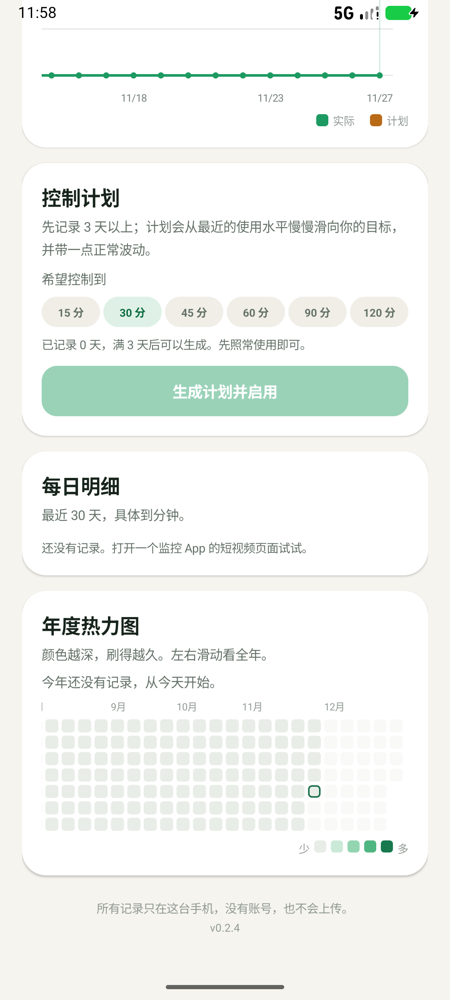
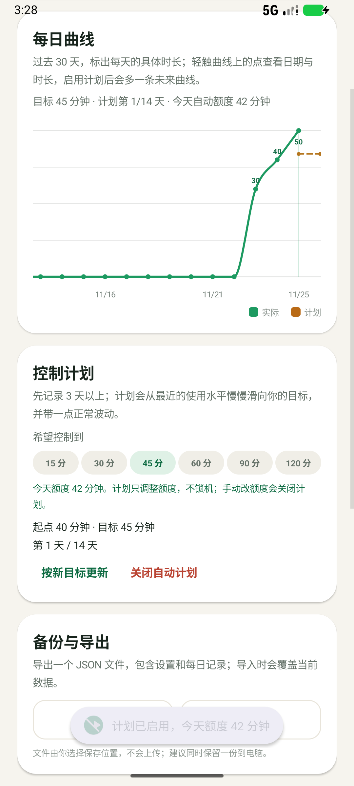
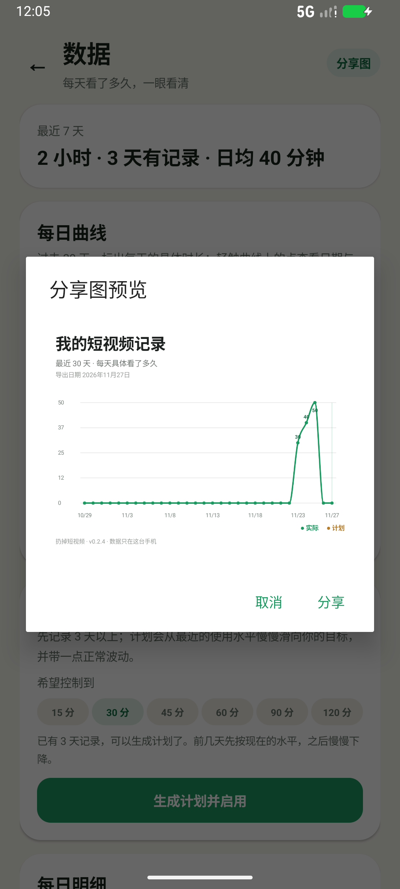
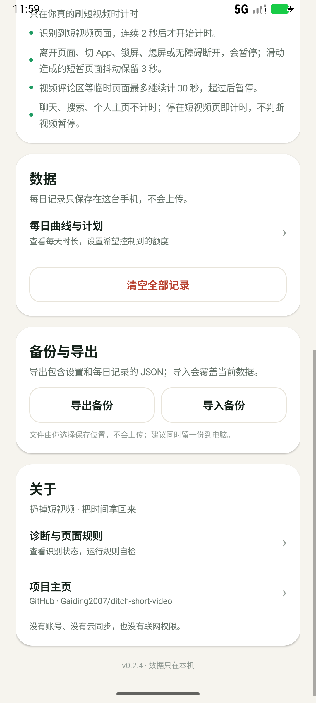
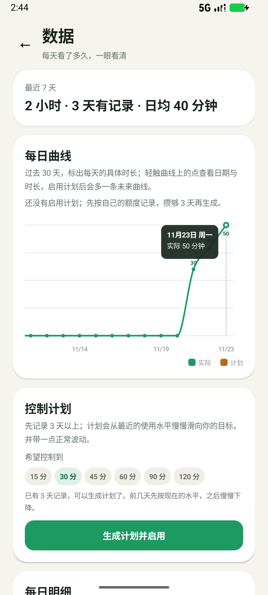
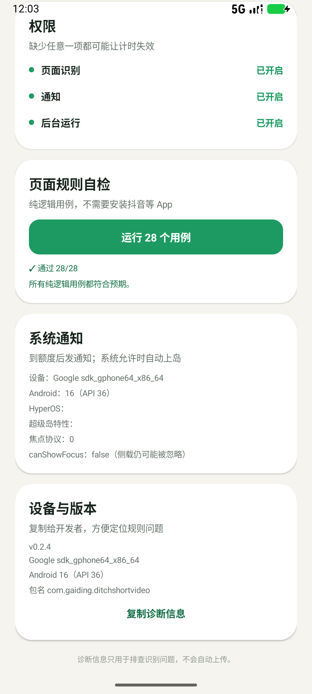

# 扔掉短视频

> 把时间，拿回来。

一个只在**真正刷短视频**时计时的 Android 应用。到了自己设定的每日额度，它只提醒一次，不锁机、不关 App、不上传数据。

中文名：**扔掉短视频**　英文名/仓库名：**ditch-short-video**　当前版本：**0.2.4**（内测）

[项目日志](log.md) · [GitHub 仓库](https://github.com/Gaiding2007/ditch-short-video) · [下载 APK](https://github.com/Gaiding2007/ditch-short-video/releases/latest)

---

## 截图

| 首页 | 设置 |
| --- | --- |
|  |  |

| 每日曲线 | 自动控制计划 |
| --- | --- |
|  |  |

| 分享图 | 本地备份 |
| --- | --- |
|  |  |

| 曲线触摸浮标 |
| --- |
|  |

| 诊断与页面规则自检 | 超时提醒 |
| --- | --- |
|  |  |

| 计时中的常驻倒计时 |
| --- |
|  |

---

## 它做什么

- **只在短视频页面计时**：抖音推荐流、快手发现流、微信视频号首页、小红书视频笔记/视频流、B 站故事模式才算；聊天、搜索、个人主页不计时，评论区短暂停留最多宽限 30 秒。
- **暂停很及时**：离开页面、切 App、锁屏、熄屏、无障碍服务断开，暂停计时；回到页面后继续累计。普通页面抖动保留 3 秒，避免 ColorOS 的 SystemUI/输入法覆盖窗口造成频繁停表。
- **最近事件日志**：诊断页记录最近 80 条页面/计时事件（不记录页面文字），可一键复制；遇到漏计/计时图标断续时，先看这里。
- **每日总额度**：5 个 App 合并计算，默认 30 分钟，可设 1–1440 分钟；每天 0 点重置。
- **计时中的常驻倒计时**：识别到短视频页面后，通知栏会出现一条静默倒计时，显示还能看多久；下拉通知栏不会瞬间消失，暂停后保留 3 秒再收起。
- **超时只提醒一次**：标题和正文可自定义，支持 `{used}` / `{limit}` 占位符；不强制拦截。
- **小米超级岛尽力适配**：Android 16 的 promoted ongoing 通知作为主路径；系统支持就上岛，不支持就普通通知。0.2.2 起设置页不再放测试按钮，普通通知/上岛由系统自动决定。
- **独立数据页**：每天的具体时长、30 天每日曲线、每日明细和年度热力图都收进独立页面；首页右上角有“数据”入口，不用再向下滚。
- **平滑曲线与触摸浮标**：每日曲线用平滑曲线连接数据点，点上显示分钟标签；轻触任意点会弹出小标签，显示具体日期、实际时长和计划额度。
- **自动控制计划**：选一个希望控制到的目标时长（15–120 分钟）；积累 3 天记录后，生成 14 天从当前水平滑向目标、带轻微噪声的计划曲线，并自动把每日额度设为计划值。前 3 天先维持现状，之后逐步调整；目标档位可直接点选，已启用后也可按新目标更新或关闭。
- **导出分享图**：数据页右上角“分享图”把最近 30 天曲线渲染成一张 1440px 的 PNG；0.2.3 起先弹预览，确认后再交给系统分享面板，不申请存储权限。
- **后台守护（尽力而为）**：0.2.4 起不再使用前台服务和常驻通知，只保留 15 分钟 watchdog、断开提醒和 ColorOS 保活引导，避免通知栏一直挂着“页面识别守护中”。Android 不允许普通 App 自行重开无障碍，被强行停止后仍需用户点一次；没有前台服务后，后台存活能力会比 0.2.3 弱。
- **本地备份**：设置页可把设置、监控 App、计划状态和每日记录导出为 JSON，也能从 JSON 恢复；文件位置由系统文件选择器决定，导入会覆盖当前数据。
- **类 GitHub 小绿点**：数据页年度热力图，颜色越深代表当天刷得越久；今天有描边，未来日期淡灰。
- **数据只在本地**：没有账号、没有云同步，App 没有申请联网权限。
- **断开提醒**：页面识别被系统关闭或服务中断时，发一条可点击的通知，点按直接跳到系统无障碍设置；重新连接后自动收起。

## 第一版支持的 App

| App | 包名 | 计时页面 |
| --- | --- | --- |
| 抖音 | `com.ss.android.ugc.aweme` | 推荐流主页面（`MainActivity` + 互动栏/视频画面；Activity 为空时用强页面证据兜底） |
| 快手 | `com.smile.gifmaker` | 发现/精选首页（`HomeActivity` + 顶部标签 + 互动/画面；Activity 为空时用强页面证据兜底） |
| 微信视频号 | `com.tencent.mm` | 视频号首页（`FinderHomeAffinityUI`），不统计聊天/朋友圈 |
| 小红书 | `com.xingin.xhs` | 视频笔记或视频流（有画面/播放进度 + 互动证据） |
| 哔哩哔哩 | `tv.danmaku.bili` | 故事/竖屏播放页（`story_title` 结构优先，Activity 暂时缺失/残留也能识别） |

第一版只支持这 5 个 App；更多 App 与自定义规则放在后续版本。

## 怎么判断“真的在刷”

采用**严格页面识别**，宁可漏计，不误计：

1. 先按包名过滤，只处理被监控的 App。
2. 从 `TYPE_WINDOW_STATE_CHANGED` 事件里拿当前 Activity；只接受真正的 Activity/UI 类，评论弹层、Popup、FrameLayout 不会清空底层页面。
3. 用 Activity 名 + 页面结构/互动栏标签/视频控件做组合判断；B 站优先看故事页标题结构，小红书优先看视频画面/播放进度，抖音/快手在 Activity 为空时也允许用“视频画面 + 标签 + 互动”强证据兜底。
4. 搜索页、输入框聚焦、图文页、普通视频详情页等直接否决；评论区等临时页最多宽限 30 秒，普通页面抖动/短暂切换保留 3 秒。
5. 连续 2 秒都识别为短视频页面才开始计时；B 站/小红书进入页面后的 8 秒内会主动重抓节点树，避免第一次打开时事件早于页面内容；离开 App、锁屏、熄屏暂停，短暂 SystemUI/输入法覆盖最多保留 3 秒。

> 停在短视频页面就计时，不额外判断视频是否暂停、评论区是否展开。页面规则基于 2026-11 的 App 版本，App 大改版后可能失效。

## 安装

0.1.0 起使用 **release 签名**，0.2.0 起的 APK 文件名带版本号，例如 `ditch-short-video-0.2.4.apk`；可以从 [GitHub Releases](https://github.com/Gaiding2007/ditch-short-video/releases/latest) 下载，也可以本地构建：

```powershell
# 在项目根目录构建（首次会下载 Gradle 8.14）
.\gradlew.bat :app:assembleRelease

# 产物（另有兼容用的 app-release.apk）
# app\build\outputs\apk\release\ditch-short-video-0.2.4.apk
```

本地构建 release 需要 `keystore/release.properties` 和 `keystore/ditch-release.jks`；这两个文件已被 `.gitignore` 排除，不随仓库分发。

也可以直接用 Android Studio 打开项目，等待同步完成后运行 `app`。`local.properties` 里的 `sdk.dir` 由本机 Android Studio 生成，不提交到仓库。

> 从 0.0.5（debug 签名）升级到 0.1.0（release 签名）必须**先卸载旧版**，否则会报签名不一致。卸载会清空本地记录；内测朋友请直接全新安装 0.1.0。0.1.1 与 0.1.0 使用同一 release 签名，可以直接覆盖升级，不用卸载。

安装后，按首页“开始前，只差这几步”依次完成：

1. **开启页面识别**：系统设置 → 无障碍 → 扔掉短视频 → 开启。
2. **允许通知**：Android 13+ 需要通知权限；否则超时提醒无法送达。
3. **允许后台运行**：小米手机建议把省电策略设为“无限制”，并允许自启动；否则系统可能清理计时服务。
4. **OPPO / ColorOS**：设置页会额外显示“OPPO / ColorOS 保活”卡，按卡片打开自启动、电池无限制、允许后台运行，并把最近任务加锁。系统仍可能清理；被强行停止后需要手动打开一次 App 或无障碍设置。

## 开发

- Kotlin，纯平台 View/API，无 AndroidX/Compose 依赖
- `minSdk 26` / `compileSdk 36` / `targetSdk 36`
- AGP `8.13.1`，Kotlin `2.2.20`，Gradle `8.14`
- 包名：`com.gaiding.ditchshortvideo`
- 发布签名：`keystore/ditch-release.jks`（RSA 4096，30 年），alias `ditch-release`；证书 SHA-256 `8D:58:21:E8:F5:F9:B3:03:E5:6A:98:0E:85:2A:85:B4:EE:F2:32:66:16:57:C6:51:39:64:C5:93:F6:F9:B5:0D`
- `keystore/release.properties` 保存签名配置，和 `.jks` 一样被 `.gitignore` 排除；密码另存 `.secrets/release-keystore.txt`，**务必离线备份，丢失后无法再升级已安装的 App**。
- 调试构建仍使用 `keystore/debug.keystore`，只用于本地调试；不要拿 debug 包对外分发。

开发第一版时所在环境无法联网下载 AGP 的 `aapt2`，因此本地构建通过命令行额外传入：

```powershell
.\gradlew.bat :app:assembleRelease `
  -Pandroid.aapt2FromMavenOverride="D:\applications\SDK\build-tools\36.1.0\aapt2.exe"
```

普通联网环境不需要这个参数，Android Studio 同步后直接构建即可。

页面规则自检在 App 内 **设置 → 诊断与页面规则 → 运行 28 个用例**，不依赖安装真实短视频 App。

## 权限

| 权限 | 用途 |
| --- | --- |
| `BIND_ACCESSIBILITY_SERVICE` | 读取当前页面结构，判断是否短视频页面 |
| `POST_NOTIFICATIONS` | 超时提醒、计时中的倒计时、断线提醒 |
| `POST_PROMOTED_NOTIFICATIONS` | Android 16 上请求 promoted ongoing（超级岛/实时更新） |
| `RECEIVE_BOOT_COMPLETED` | 开机重建 15 分钟 watchdog |
| `REQUEST_IGNORE_BATTERY_OPTIMIZATIONS` | 跳转系统省电设置，降低后台被清理概率 |
| `VIBRATE` | 提醒振动 |

没有 `INTERNET` 权限；数据只写入本机 SharedPreferences。

## 已知限制

- 5 个 App 的页面规则已在模拟器和本地伪 App 上验证，但**尚未在真实小米 15 Pro 上逐页验证**；App 改版可能导致漏计/误计。遇到不计时，请到诊断页复制当前 Activity/识别原因反馈。
- 只保证普通全屏场景；分屏/小窗的页面归属不保证准确。
- 评论区：临时页面最多继续计 30 秒，普通页面抖动/短暂切换保留 3 秒；如果评论页特征识别不到，会按普通 3 秒宽限暂停。这是 0.1.2 的折中策略。
- 小米超级岛取决于系统版本和通知权限；侧载应用通常拿不到官方焦点通知权限，`miui.focus.param` 可能被系统忽略。没有上岛时会回退为普通通知。
- B 站首次进入故事页的修复基于“故事标题 + 视频画面 + 8 秒重抓”；真实 B 站版本若改掉 `story_title` 或改用其他播放器，仍可能失效。遇到漏计，请到诊断页复制 Activity/识别原因反馈。
- 0.1.0 起使用 release 签名，可做小范围内测；仍未做应用商店上架、隐私政策和正式商店资料。
- 一加/ColorOS 的页面事件有时不提供 Activity 类名；0.1.1 已对抖音/快手增加强页面证据兜底，并在诊断页记录最近事件；0.1.2 进一步把 SystemUI/输入法覆盖窗口与真实切 App 区分开，并保留 3 秒。若仍漏计，请复制诊断信息，重点看“最近事件”里是否还有 Activity 为空、覆盖窗口切换或服务断开。
- “强行停止”App 会同时停掉无障碍服务和守护闹钟；ColorOS 清理后仍需用户打开一次 App 或无障碍设置。0.2.4 移除了前台服务，只保留 15 分钟 watchdog、断线通知和 OPPO 保活引导，后台存活能力比 0.2.3 弱，不能绕过系统安全模型。
- 计时中的倒计时是 LOW 重要度静默通知，不会响铃或震动；下拉通知栏可见，暂停后 3 秒收起。

## 版本

- `0.2.4` — 2026-11-27：移除“页面识别守护中”常驻通知和对应的 `specialUse` 前台服务，保留 15 分钟 watchdog 与断线提醒；删除设置页额度卡，把 JSON 备份/导入迁到设置；删除首页“你的数据”卡，只保留右上角“数据”入口；版本 0.2.4。后台存活能力比 0.2.3 弱，OPPO/ColorOS 仍需手动保活。
- `0.2.3` — 2026-11-26：分享图先预览再分享；新增 `specialUse` 前台守护服务、15 分钟断线 watchdog、断线通知和 OPPO/ColorOS 保活引导；版本 0.2.3。系统仍不允许自动重开无障碍，只能降低断开概率并缩短恢复路径。
- `0.2.2` — 2026-11-25：修复控制计划时长点不动；首页右上角新增“数据”入口；数据页新增分享图和本地 JSON 备份/导入；移除设置/诊断里的小米超级岛测试入口；版本 0.2.2。
- `0.2.1` — 2026-11-23：每日曲线改为平滑曲线；点上增加分钟标签；触摸点弹出日期/实际时长/计划额度小浮标；触摸横向拖动不抢滚动；版本 0.2.1。
- `0.2.0` — 2026-11-23：新增独立数据页（每日曲线、每日明细、年度热力图）、3 天门槛的 14 天自动额度计划（带轻微噪声）、B 站评论区特征、APK 版本化命名；28 项自检；release 签名可覆盖 0.1.2。
- `0.1.2` — 2026-11-17：把页面抖动宽限/倒计时保留从 2 秒延长到 3 秒；识别并暂缓 SystemUI、输入法覆盖窗口，不再因此重置抖音/快手 Activity；26 项自检；同一 release 签名可覆盖 0.1.1。
- `0.1.1` — 2026-11-17：一加等 OEM 的 Activity 为空兜底（抖音/快手）、新增最近事件日志与诊断复制、首页区分“已开启但未连接”；26 项自检；同一 release 签名可覆盖 0.1.0。
- `0.1.0` — 2026-11-17：首个 release 签名内测版；版本号 `0.1.0` / versionCode `10`；功能与 0.0.5 一致，切换正式发布证书，用于超小范围内测。
- `0.0.5` — 2026-11-17：新增无障碍断开提醒，点击通知直达系统无障碍设置；重新连接自动取消；后台保活仍只做提醒，不加前台服务。
- `0.0.4` — 2026-11-17：修复 B 站首次打开故事页不计时（故事标题兜底 + 8 秒重抓 + 清除过期 Activity）；软件内版本号改用 `BuildConfig.VERSION_NAME`；22 项自检。
- `0.0.3` — 2026-11-17：B 站故事页结构兜底、小红书视频流识别、评论区 30 秒宽限/普通切换 2 秒、倒计时收起缩短到 2 秒；21 项自检。
- `0.0.2` — 2026-11-17：上限提高到 1440 分钟；修复评论弹层/滑动导致停表；放宽抖音/快手/小红书识别；新增计时中的常驻倒计时；17 项自检。
- `0.0.1` — 2026-11-16：首个可运行版本：5 App 严格识别、暂停/继续、每日额度、超时提醒、小米超级岛尽力适配、年度热力图、本地存储、诊断页与 13 项自检。

详细需求、实现记录、验证结果与后续计划见 [log.md](log.md)。
